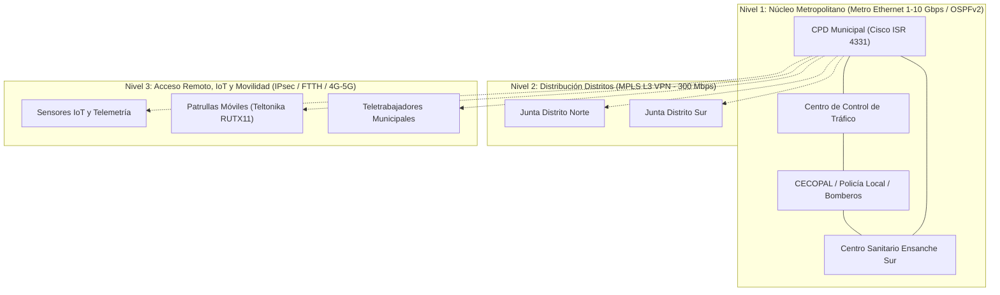

# Memorias Técnicas y Prácticas de Redes Avanzadas

Repositorio para documentación técnica, proyectos de ingeniería y memorias de diseño de infraestructuras de red (4º de Grado en Ingeniería Informática).

---

## 📑 Proyecto Destacado: Diseño de Arquitectura WAN en una Smart City (Huelva)
* **Asignatura:** Redes Avanzadas (AAD1)
* **Autor:** Alejandro Quintero Parrilla
* **Documento principal:** [📄 Ver Memoria Técnica Completa (PDF)](./Memoria_Tecnica_Arquitectura_WAN_Smart_City.pdf)

---

### 🌐 Resumen Ejecutivo del Proyecto
Diseño integral de una **Red de Área Extensa (WAN)** para conectar los servicios críticos, administrativos y ciudadanos del Ayuntamiento de Huelva bajo el concepto de *Smart City*, garantizando alta disponibilidad ($\ge 99,99\%$), baja latencia y seguridad integral.

---

### 🛠️ Tecnologías y Arquitectura Implementada

* **Modelo de Red:** Red Corporativa Convergente Resiliente.
* **Topología Jerárquica:**
  * **Nivel 1 (Núcleo):** Topología en anillo/malla sobre **Metro Ethernet** y fibra monomodo (1 Gbps - 10 Gbps) con enrutamiento dinámico **OSPFv2** para conmutación de rutas sub-segundo.
  * **Nivel 2 (Distribución):** Topología estrella (*Hub-and-Spoke*) con **MPLS L3 VPN** para interconexión de Juntas de Distrito.
  * **Nivel 3 (Acceso Remoto y Movilidad):** Enlaces **FTTH** comerciales y **4G/5G** encapsulados con túneles **VPN IPsec** (AES-256-GCM / SHA-256 / IKEv2).
* **Salida Perimetral a Internet:** Configuración **Dual-Multihomed** con dos ISPs independientes (Movistar 1 Gbps + Orange 600 Mbps) para eliminar el punto único de fallo.
* **Segmentación L2 y QoS:** 
  * Doble etiquetado **IEEE 802.1ad** (QinQ) en núcleo.
  * Separación por VLANs (Gestión, Tráfico, Voz/Emergencias, Sanidad) con marcado de prioridad **IEEE 802.1p / DSCP**.
* **Equipamiento Homologado:**
  * Routers de núcleo y sedes: **Cisco ISR Serie 4000 (4331 y 4321)**.
  * Switches de núcleo y acceso: **Cisco Catalyst 3650 (L3)** y **Catalyst Serie 1000 / 2960-X (L2)**.
  * Routers móviles embarcados: **Teltonika RUTX11** (doble SIM, 4G Cat 6, GPS, grado industrial).

---

### 📊 Estudio Económico y Gestión de Imprevistos
* **Análisis CAPEX / OPEX:** Presupuesto de inversión en hardware (23.310 €) y coste operativo de conectividad mensual (3.270 €/mes), logrando un ahorro superior al 55% frente a redes físicas aisladas.
* **Escenario Imprevisto Resuelto:** Incorporación en caliente del nuevo *Centro Sanitario y de Emergencias en el Ensanche Sur* junto con 30 cámaras de videovigilancia (180 Mbps continuos), ampliando el núcleo de 3 a 4 nodos sin disrupción de la troncal.

---

### 📂 Archivos en este Repositorio
| Archivo | Descripción |
| :--- | :--- |
| [`Memoria_Tecnica_Arquitectura_WAN_Smart_City.pdf`](./Memoria_Tecnica_Arquitectura_WAN_Smart_City.pdf) | Memoria técnica completa de 19 páginas (incluye diagramas lógicos, tablas de enrutamiento y justificación técnica). |
